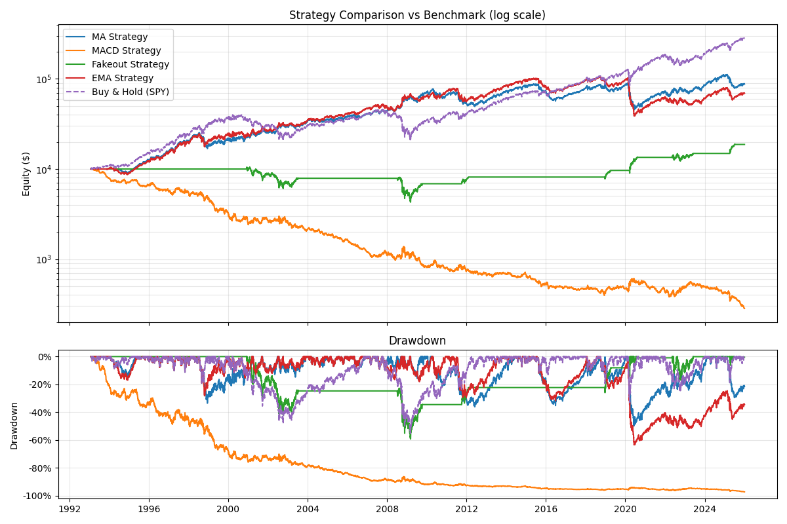

# Systematic Trading Research Project

This repository contains a Python-based framework for developing and testing systematic trading strategies in financial markets.

## Overview

The project focuses on translating price action and market structure concepts into rule-based, testable trading strategies. It includes a modular backtesting engine with performance evaluation tools.

## Features

- Historical data ingestion (Yahoo Finance)
- Strategy development framework
- Four baseline strategies: SMA crossover, EMA crossover, MACD crossover and 252-day fakeout
- Backtesting engine with next-bar execution, commission and slippage
- Performance metrics (Sharpe ratio, drawdown, win rate)
- Benchmark comparison against buy & hold, with log-scale equity and drawdown charts

## Current Focus

Ongoing development is focused on:

- Expanding price action and market structure-based strategies
- Building robust backtesting infrastructure
- Implementing risk management rules
- Developing quantitative tools using Python (NumPy, pandas)

## Tech Stack

- Python
- NumPy
- Pandas
- Matplotlib
- yfinance
- IBKR API

## IBKR Data Integration

This folder contains the integration with Interactive Brokers API as an alternative to yfinance for fetching market data.

The `IBDataFetcher` class connects directly to Trader Workstation (TWS) via `ib_insync`, retrieving real-time and historical OHLCV data for any supported ticker. This allows for more reliable and professional-grade data compared to yfinance.

Both data sources will be developed in parallel:
- **yfinance** — lightweight, no setup required, used for rapid strategy research and backtesting
- **IBKR API** — production-grade data, requires TWS running, used for live and more accurate historical data

### Requirements
- Interactive Brokers account with TWS installed and running
- API enabled in TWS settings (`Edit → Global Configuration → API → Settings`)
- `ib_insync` installed: `pip install ib_insync`

## Disclaimer

This project is for educational and research purposes only and does not constitute financial advice.

## Usage

```
python main.py
```

Downloads SPY daily data (1993–2026), runs every strategy and saves the comparison chart to `results/equity_curve_<timestamp>.png`.

## Backtest Assumptions

- Signals computed on the close of day *t* are executed on the close of day *t+1* (no look-ahead).
- Each position uses the full account; shorts keep the cash as collateral.
- Every entry and exit pays 5 bps commission + 5 bps slippage.
- Starting capital: $10,000.

## Strategies

### Moving Average Crossover (50 / 200)

Long when the 50-day simple moving average is above the 200-day, short when it is below. Aims to capture medium-to-long term trends while filtering out short-term noise.

### EMA Crossover (50 / 200)

Same rules as the SMA crossover but with exponential moving averages, which react faster to recent prices.

### MACD Crossover (Fast: 12, Slow: 26, Signal: 9)

Long when the MACD line is above its signal line, short when it is below. This baseline has no trend or volatility filters, so it trades very often and is prone to false signals in sideways markets.

### Fakeout (252-day window)

- **Bull fakeout**: price breaks below the 252-day low but closes back above it → go long.
- **Bear fakeout**: price breaks above the 252-day high but closes back below it → exit to cash (or go short if `trade_shorts=True`).

## Performance (SPY, 1993–2026, after costs)

| Strategy | Total Return | Sharpe | Max Drawdown | Win Rate (days) |
|---|---|---|---|---|
| MA Crossover 50/200 | 778% | 0.48 | -50% | 52% |
| EMA Crossover 50/200 | 594% | 0.43 | -63% | 52% |
| Fakeout 252 | 87% | 0.22 | -59% | 10% |
| MACD 12/26/9 | -97% | -0.53 | -97% | 47% |

None of the strategies beats buy & hold over the full period. The trend-following crossovers limit losses in 2000–2003 and 2008 but are caught short in the fast 2020 rebound. MACD is destroyed by transaction costs. Win rate counts winning days, so the often-flat fakeout strategy scores low.

### Equity Curve



## Roadmap

- [ ] Kalshi API integration as an alternative data source for event-driven signals
- [ ] Statistical validation of strategies using SciPy (t-tests, p-values, return distribution analysis)
- [ ] Machine learning signal generation using Scikit-learn (Random Forest, regime classification)
